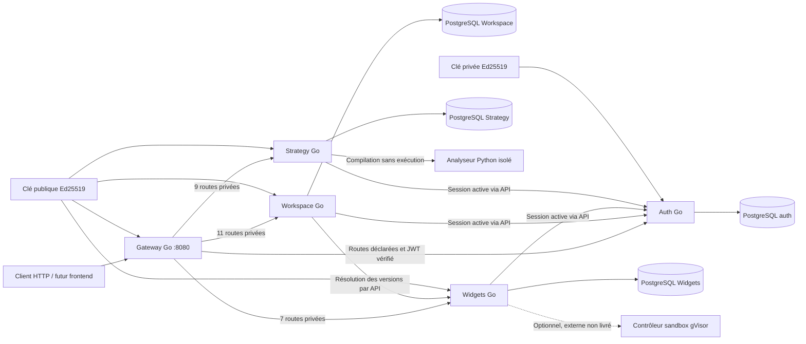
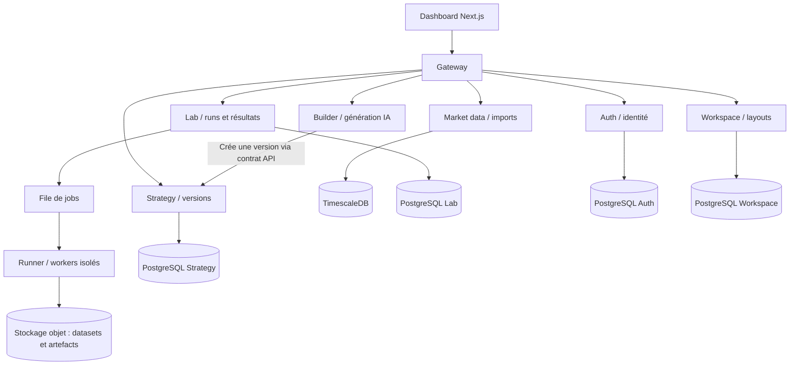

# Analyse et architecture QSlate

## Besoin et état réel du projet

QSlate (nom QuantForge dans certains documents) propose un laboratoire de
recherche quantitative accessible à deux profils : le trader qui veut valider
une idée sans programmer et l'analyste qui veut écrire ses stratégies,
indicateurs et métriques. Le parcours cible est : idée → stratégie versionnée →
backtest sur un dataset identifié → rapport comparable → éventuellement
exécution paper/live. Le dashboard doit conserver les layouts et projets de
chaque utilisateur. Les stratégies constituent des données privées.

Sources locales consultées : `CLIENT NEEDS & FUNCTIONAL SCOPE.pdf`,
`Diagram.pdf`, `CONTEXT, AUDIT & COMPLIANCE.pdf` du projet EIP et le frontend
Next.js, dans `/home/alexis/Tek 4/Qslate_archi/G-EIP-600-PAR-6-1-eip-15-main`.
La référence AREA est `/home/alexis/Tek 4/Qslate_archi/AREA/Backend`.

L'état observé de ce dépôt avant cette tranche :

| Composant | Implémentation existante | Écart avec la cible documentaire |
| --- | --- | --- |
| API | `main.py`, FastAPI ; assets, OHLCV, options, téléchargement et backtest | Pas de gateway Go ni d'identité utilisateur |
| Calcul | `runner_service.py` appelle `job_runner.py` | Le code Python fourni est exécuté par `exec` dans le processus du runner ; aucune isolation par job dans ces fichiers |
| Marché | CSV locaux, pandas et yfinance | TimescaleDB et stockage objet sont une cible, pas une implémentation ici |
| Résultats | Rapport/trades renvoyés après une requête synchrone jusqu'à 600 s | Pas de catalogue de runs, statut persistant, queue ou propriétaire |
| Frontend | Next.js, script editor et dashboard modulaire | Layouts en localStorage ; liens login/register sans parcours de connexion implémenté |
| Builder et live | Décrits dans les documents | Absents du backend consulté |

La séparation API/runner existe déjà, mais ne constitue pas une sandbox.
Un validateur AST apporte un filtre préalable ; il ne remplace pas une
isolation système, des quotas et une politique réseau.

## Ce que l'on reprend d'AREA

AREA est une plateforme d'automatisation, structurée autour d'un gateway et
de services Auth, Area, Service catalog, Webhook, Polling, Cron et Mail. Les
responsabilités métier de QSlate sont différentes : on reprend son organisation
technique, pas son découpage fonctionnel.

Son gateway charge `services-config/**/service.config.json`, route vers des
services Go, applique l'authentification et les règles internes. Le template
AREA contient un `app/cmd`, des couches `http`, `service`, `repository`,
`domain`, une configuration, PostgreSQL et Docker/OpenAPI. Chaque service
possède ses données. Les interfaces de repository et les tests de service
AREA sont déjà de bons points : la base n'est pas requise pour tous ses tests.

Points précis améliorés dans cette tranche :

| Référence AREA consultée | Choix QSlate et raison |
| --- | --- |
| Routes directes et routes préfixées en parallèle | Un chemin public canonique par méthode, liste explicite ; éviter ambiguïtés et collisions |
| JWT HS256 avec secret de développement par défaut dans Auth | Ed25519 : auth signe avec la clé privée, gateway vérifie uniquement avec la clé publique ; clés générées, aucun secret de signature par défaut |
| `isValidUsername` retourne toujours `true` dans le service Auth observé | Validation effective, normalisation email/username et contraintes SQL |
| Couche DB appelle `log.Fatal`, DSN par champs avec SSL désactivé | Erreurs remontées au point d'entrée ; `DATABASE_URL`, pool limité, timeouts et contextes |
| SQL dans `db/init`, exécuté seulement sur une base neuve | Migrations embarquées versionnées avec transaction, verrou concurrent et checksum |
| Template lié à une fausse ressource users | Template neutre et générateur qui réécrit les imports, sans DB obligatoire |
| Modules et construction propres à chaque service | Même autonomie conservée : `go.mod`, checksums, Dockerfile et helpers techniques locaux ; Compose racine pour orchestrer le développement |
| Secret partagé pour certaines routes internes | Pas de route interne publiée dans cette tranche ; futures identités de service dédiées, pas de confiance dans `X-User-ID` fourni par le client |

Chaque service et le gateway sont désormais des modules Go indépendants, avec
leur seul dossier comme contexte Docker. Le `go.work` racine facilite l'édition,
mais les builds/tests imposent `GOWORK=off` et aucun `replace` local. Le socle
technique est copié dans chaque `internal/platform`, comme les helpers locaux
d'AREA ; aucune entité métier ni repository n'est partagé. Le template produit
un nouveau module autonome, sans mettre à jour les services déjà créés.

Les tests d'architecture compilent les composants après les avoir copiés dans
des dossiers temporaires hors du dépôt, interdisent les imports racine/voisins
et testent aussi un service généré. La CI et le Makefile parcourent explicitement
les modules : `go test ./...` lancé à la racine ne couvre que les outils/tests
transverses. Les mises à jour de sécurité des helpers doivent être reportées
dans les copies concernées ; cette duplication contrôlée privilégie l'autonomie.

## Socle implémenté



Le gateway publie les 14 opérations Auth sous `/qslate/v1/auth` et
`/qslate/v1/users/me`, plus les 3 routes OAuth2. Les opérations sensibles
(login/register, actions email, création de clé, authorize/callback) partagent
10 appels par minute et IP pour une instance de gateway. Les routes privées
exigent un JWT valide au gateway **et** au service, ainsi qu'une session active
en base Auth. Workspace publie aussi les 11 opérations de la section 3,
contrôle le propriétaire dans sa base et vérifie chaque session par l'API Auth.
Aucune route des autres domaines n'est publiée implicitement.
Les probes `/healthz` et `/readyz` ont des rôles distincts ; readiness du
gateway vérifie les upstreams.

Compose publie le gateway sur `127.0.0.1:8080` et Mailpit, uniquement pour le
développement, sur `127.0.0.1:8025`. PostgreSQL n'a aucun port hôte.
Chaque base se trouve sur un réseau accessible uniquement à son service,
pas au gateway ni à l'autre service. La clé privée
n'est montée que dans auth. Les services Go tournent avec un utilisateur
non privilégié, un filesystem en lecture seule et sans capacités Linux.
Auth dispose d'une sortie réseau pour les fournisseurs OAuth2 et SMTP.

### Identité modulaire et OAuth2

Le domaine et les cas d'utilisation ne connaissent aucun fournisseur. Les
adaptateurs HTTP/OAuth2 aboutissent tous à la même émission de session :

```text
Login/register mot de passe ─┐
                            ├─ Auth.session → JWT + cookie refresh → PostgreSQL Auth
OAuth2 : config → adaptateur ┘
```

L'adaptateur charge `config/providers.json` depuis le dossier Auth (ou
`OAUTH_PROVIDERS_FILE`) : endpoints, scopes, mapping de claims, callback,
paramètres et références aux variables d'environnement des secrets. Il n'y
a pas de sélection codée par nom de fournisseur. Les secrets Compose sont
injectés via `.env.oauth`, jamais inclus dans le JSON ni l'image.

Authorization Code + PKCE S256, état lié au navigateur et au fournisseur,
usage unique et expiration protègent le callback. Des URLs de callback
distinctes sont imposées par fournisseur ; les requêtes token/userinfo
n'acceptent aucune redirection HTTP. Le transport distant exige HTTPS.
Ces choix s'appuient sur les [recommandations OAuth2 actuelles (RFC 9700)](https://www.rfc-editor.org/rfc/rfc9700.html).
Cette intégration utilise userinfo, pas une validation complète d'ID tokens OIDC.
L'association externe est `(provider, subject)` ; aucun compte n'est lié
automatiquement à un autre sur la seule égalité d'email.

Les refresh tokens sont opaques, hachés en base et tournants ; un rejeu
révoque la famille. Logout/reset invalident les sessions concernées. Les
services futurs devront vérifier l'état de session pour offrir la même
révocation immédiate ; la signature JWT seule ne suffit pas.
Les liens email à usage unique sont mis en outbox transactionnelle chiffrée
et envoyés par l'adaptateur SMTP ; aucun appel SMTP dans le handler métier.
L'outbox reste dans Auth pour cette tranche : un service Notifications pourra
la consommer plus tard via un contrat de transport explicite.

Les choix précis et limites se trouvent dans [contracts.md](contracts.md).
Le contrat REST recense 95 opérations issues du PDF + 3 extensions OAuth2 ;
44 opérations d'API sont implémentées : 17 Auth/OAuth2, 11 Workspace, 7 Widgets
et 9 Strategy. Strategy possède sa base, des versions immuables, l'import `.py`,
la restauration optimiste et les diagnostics via un analyseur Python 3.13 séparé.
Cet analyseur ne reçoit ni JWT ni secrets ni accès DB ; il compile sans exécuter,
avec des limites CPU/mémoire/PID/temps et un réseau interne unique.
La route de preview est une admission configurable vers une infrastructure
gVisor externe, désactivée par défaut ; le runtime n'est pas livré ni validé ici.
Les autres domaines
et les deux flux AsyncAPI restent planifiés ; les chemins tronqués du PDF
et les payloads reconstruits sont identifiés comme propositions.

Le frontend et l'API Python conservent leur configuration actuelle : cette
tranche n'inclut pas encore leur intégration au gateway. Les conteneurs
du moteur de backtest ne sont pas ajoutés au Compose ; seul l'analyseur statique
Python de Strategy est désormais livré dans la pile de développement.

## Découpage cible, à implémenter progressivement



| Service | Possède | Ne doit pas faire |
| --- | --- | --- |
| Auth | Comptes, mots de passe, sessions, identités OAuth2, préférences de compte, clés API Runner ; MFA à venir | Conserver clés de brokers ou stratégies |
| Workspace | Projets, layouts, préférences de workspace, références de widgets | Transformer chaque widget UI en microservice |
| Strategy | Code/versions immuables, paramètres, import, diagnostics via analyseur isolé | Exécuter le code utilisateur ou autoriser un run sur un simple résultat de lint |
| Market data | Catalogue, import, providers, OHLCV, versions des datasets | Orchestrer un backtest |
| Lab | Admission/quota, lifecycle des runs, référence de stratégie/dataset, résultats | Bloquer une requête interactive pendant un calcul |
| Runner | Consommer un job, lancer/arrêter les workers, déposer les artefacts | Être un endpoint public qui exécute du Python dans son processus |
| Builder | Générer et expliquer une stratégie, validation préalable, quotas IA | Conserver l'identité ou devenir une dépendance obligatoire du Lab |

PostgreSQL par propriétaire logique ; au début plusieurs bases/rôles peuvent
partager un serveur, sans jointures entre services. TimescaleDB et stockage
objet ne sont introduits que lors de l'extraction des données/calculs.
Les contrats HTTP courts restent synchrones. Le futur lancement de backtest
renvoie `202` et un `run_id`; une queue durable traite les jobs avec retry,
idempotence, cancellation et dead-letter. Les événements sont versionnés
(`run.completed.v1`) et une outbox évite les incohérences DB/queue.

## Prochaines tranches

1. Brancher les formulaires du frontend, le cookie HttpOnly, les liens email
   et le callback OAuth2 ; valider les chemins/payloads proposés avec le frontend.
2. Déployer/valider le contrôleur sandbox de preview ; Strategy fournit désormais
   CRUD/import/historique/restauration et diagnostics, pas l'exécution utilisateur.
   Brancher Monaco et ajouter les politiques AST d'exécution séparément.
3. Extraire Market data et Lab, figer stratégie/dataset par run.
4. Introduire queue et workers séparés ; durcir l'exécution avec gVisor/Kata,
   quotas CPU/mémoire/temps, réseau contrôlé et séparation des secrets.
5. Builder puis broker/paper/live seulement après cette frontière d'exécution.

Le socle ne fournit pas encore MFA, liaison explicite de comptes, JWKS ni
rotation sans interruption. Les access tokens durent 15 minutes par défaut.
Les clés publiques sont injectées par fichier et partagées par déploiement.
Le rate limiter est en mémoire : un stockage commun sera nécessaire si plusieurs
gateways doivent partager les quotas. Un reverse proxy de production devra
fournir une politique explicite de confiance des IP ; ici `RemoteAddr` est
utilisé et les headers forwarded du client ne sont pas des identités fiables.
