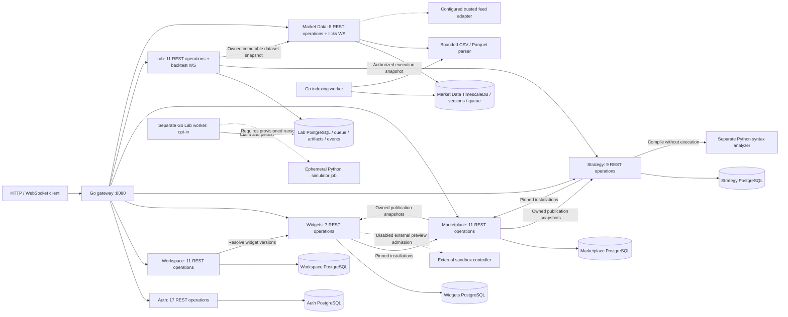

# QSlate architecture and implementation status

## Product needs and original assessment

QSlate (called QuantForge in some original documents) is a quantitative research
lab for traders who want to validate ideas without coding and analysts who write
strategies, indicators and metrics. The intended workflow is: idea → versioned
strategy → backtest against an identified dataset → comparable report →
eventually paper/live execution. Dashboards must retain each user's layouts and
projects; strategy source is private unless deliberately shared.

The initial assessment used the EIP project's `CLIENT NEEDS & FUNCTIONAL SCOPE.pdf`,
`Diagram.pdf`, `CONTEXT, AUDIT & COMPLIANCE.pdf` and Next.js frontend in
`G-EIP-600-PAR-6-1-eip-15-main`. AREA's `Backend` directory was the architectural
reference. These are historical assessment sources, not runtime dependencies.

Before the Go foundation, this repository had:

| Component | Original implementation | Gap from the target |
| --- | --- | --- |
| API | Root `main.py`, FastAPI assets/OHLCV/options/download/backtest routes | No Go gateway or user identity |
| Calculation | `runner_service.py` calling `job_runner.py` | User Python executed with `exec` in the runner process; no per-job sandbox |
| Market data | Local CSV, pandas and yfinance | TimescaleDB and object storage were targets, not implementations |
| Results | Synchronous report/trades response, up to 600 seconds | No durable run catalogue, owner or queue |
| Original frontend | Next.js editor/modular dashboard; localStorage layouts | Login/register integration and server-side layout persistence still needed |
| Builder/live | Described in product documents | Not implemented in the inspected backend |

The legacy root Python files were removed and remain available in Git history.
The current Python engine lives under `simulator/`. Separating
an HTTP API from a Python runner is not itself a sandbox; syntax/AST checks do not
replace system isolation, resource limits or network policy.

## What QSlate takes from AREA

AREA is an automation platform with a gateway and Auth, Area, Service catalogue,
Webhook, Polling, Cron and Mail services. QSlate reuses its technical organization,
not its business-domain split.

The inspected AREA gateway loads `services-config/**/service.config.json` and
routes to Go services with authentication/internal policies. Its template has an
`app/cmd` entry point, HTTP/service/repository/domain layers, configuration,
PostgreSQL, Docker and OpenAPI. Services own their data, and repository interfaces
allow use-case tests without a real database.

| Observed AREA pattern | QSlate decision |
| --- | --- |
| Parallel direct and prefixed routes | One explicit canonical public method/path mapping |
| Development HS256 signing secret in Auth | Generated Ed25519 keys; only Auth signs, consumers receive the public key |
| Username validation returning `true` in the inspected Auth implementation | Real validation, normalization and database constraints |
| Database helpers calling `log.Fatal`; field-built non-TLS DSNs | Errors returned to the entry point; explicit `DATABASE_URL`, bounded pools and timeouts |
| Fresh-database SQL initialization only | Embedded immutable migrations with transactions, locks and checksums |
| Template tied to a placeholder users resource | Neutral runnable template and a generator that rewrites imports; database optional |
| Independent service modules/builds | Preserve that independence, including local technical helpers and component-only Docker contexts |
| Shared secrets for some internal routes | No private catalogue/analysis route at the gateway; explicit verified-user delegation, with workload authentication still a deployment concern |

Each Go component owns `go.mod`, `go.sum`, Dockerfile, Makefile, configuration
and local `internal/platform` helpers. There are no root/sibling runtime imports
or local module replacements. `go.work` is an optional editing aid; builds/tests
use `GOWORK=off`. Updating the template never silently updates an existing service.

Architecture tests copy components outside the repository and compile them in
isolation, reject cross-service imports and verify generated services. The root
Makefile and Go CI iterate over modules explicitly: root `go test ./...` does
not cover child modules. Security fixes to copied helpers must be propagated
and tested in every affected service.

## Implemented stack

The gateway publishes 74 REST operations: 17 Auth/OAuth2, 11 Workspace, 7 Widgets,
9 Strategy, 11 Marketplace, 11 Lab and 8 Market Data. It also forwards backtest
and market-tick WebSockets.
The canonical contract still contains 98 REST operations and two stream channels;
unimplemented operations remain explicitly planned.



Private REST operations verify JWT signatures, issuer, audience and expiration,
then check live Auth sessions and resource ownership in the responsible service.
The diagram omits repeated session-validation edges for readability. Auth's
private key is mounted only into Auth; business APIs and the gateway receive only
the public key. The Lab worker and user jobs receive no Auth keys.

Sensitive Auth operations share an in-memory gateway limit of 10 requests per
minute per client IP. The gateway removes supplied identity/forwarding headers.
Marketplace's five reads are public. Both browser-compatible WebSockets
authenticate in their first frame, without a gateway Bearer-header requirement.
An otherwise valid JWT alone never grants access to another user's resources.

`/healthz` checks process liveness; `/readyz` checks the component's documented
dependencies. Gateway readiness checks configured upstreams. Marketplace, Lab
and Market Data readiness check their own database, avoiding readiness cycles and making existing
read-side data available independently of admission dependencies.

Compose exposes only the gateway on `127.0.0.1:8080` and development Mailpit on
`127.0.0.1:8025`. Business databases have no host ports and use service-owned
storage networks. The Lab API and worker share only Lab's own database. Go
application containers are non-root, read-only and capability-free. Auth has
outbound connectivity for OAuth2/SMTP. Private networks are not a replacement
for production workload authentication.

## Identity, sessions and configurable OAuth2

Password and OAuth2 adapters use the same session-issuance use case:

```text
Password login/register ──┐
                         ├─ Auth session → JWT + refresh cookie → Auth PostgreSQL
Configured OAuth2 flow ───┘
```

`OAUTH_PROVIDERS_FILE` selects Auth's provider JSON. Provider URLs, scopes,
claim mappings, callback URLs, parameters and credential environment-variable
names are configuration, not provider-name branches in code. Compose supplies
secrets through ignored `.env.oauth`; JSON and images contain no credentials.

Authorization Code + PKCE S256 uses expiring, single-use state bound to the
browser and provider. Callbacks are distinct per provider. Token/userinfo HTTP
redirects are rejected; remote provider endpoints require HTTPS. The security
reference is [OAuth 2.0 Security BCP, RFC 9700](https://www.rfc-editor.org/rfc/rfc9700.html).
This integration uses authenticated userinfo, not full OIDC ID-token validation.

External identities use `(provider, subject)`; matching emails never
automatically link accounts. Opaque refresh tokens are hashed and rotated;
replay revokes the session family. Logout/password reset revoke the affected
sessions. All implemented private business services validate those sessions
through Auth's API; a future service must preserve that rule.

Email links use a transactional encrypted outbox inside Auth and a separate
SMTP adapter. Delivery is at least once. A future Notifications service would
need an explicit transport contract rather than direct access to Auth's tables.
See [contracts.md](contracts.md) for precise cookie, email and API-key behavior.

## Strategy analysis and widget preview

Strategy owns immutable Python drafts, import/history, optimistic restore and
syntax diagnostics. Its separate Python 3.13 analyzer receives only source and
language, no JWT, credentials or database access. Each request compiles without
executing code in a disposable interpreter with CPU/memory/PID/time bounds.

This is syntax/scope checking, not execution approval, type/style linting or
section 10 AST security policy. A malicious program can be syntactically valid.
Widget preview is a configurable dispatch boundary to an external gVisor
controller, disabled by default. That controller/runtime is not shipped or
validated by preview's HTTP-dispatch tests.

## Lab execution boundary

Lab's independent Go API resolves exact owned or actively installed strategy
versions through Strategy's private authenticated execution-snapshot endpoint.
It obtains an exact owned ready dataset/version from Market Data over a private
authenticated HTTP contract, verifies its checksum, then freezes source,
CSV, hashes and effective parameters, then atomically stores the queue entry
and idempotency receipt in its own PostgreSQL database.

The separate Go worker uses fenced, leased `FOR UPDATE SKIP LOCKED` claims.
Only the worker can access the execution-daemon socket. It creates an offline,
non-root, read-only runsc container for each job with no host mounts, credentials
or Auth keys, bounded CPU/memory/PIDs/tmpfs/output and a worker-enforced deadline.
The simulator is imported from branch #18; the resolved immutable image ID and
base engine revision are recorded. The API never executes Python.

Cancellation kills the labelled container before releasing its claim. Late
results cannot overwrite cancellation or recovery. A replacement worker cleans
expired claims and marks interrupted runs failed; it never automatically retries
arbitrary code. Persisted events support authenticated WS replay. Progress is
live; captured logs and strategy telemetry are delivered after completion.

Execution is disabled by default and fails closed unless configuration, a fresh
ready worker, the runsc runtime, image and pinned data are available. An optional
operator-managed CSV adapter remains for standalone Lab without a configured
Market Data origin; remote errors never fall back to it. No daemon-level deadline reaper
is bundled: after total worker failure, cleanup requires a worker to return.
Production runsc provisioning/validation remains a deployment task. See
[Lab](../services/lab/README.md) for configuration and operational limitations.

## Market Data boundary

Market Data owns raw CSV/Parquet uploads, mappings, immutable ready versions,
canonical CSV snapshots, indexing jobs and OHLCV points in its own TimescaleDB.
The API and worker call a bounded private Python parser. They never execute
uploaded code. Owner-scoped quotas, optimistic mapping revisions, idempotent
validation and fenced claims bound concurrent work and preserve completed versions.

Lab receives only the authorized version's canonical bytes and checksum; it
persists its own frozen copy, so later mapping or deletion cannot change a run.
Neither service reads the other's tables. The default feed is disabled. A trusted,
file-configured HTTP adapter supplies real provider history/ticks; broker-specific
connectors, per-user broker credentials and durable tick replay remain separate work.

## Domain boundaries and remaining work

| Domain | Owns / intended responsibility | Must not do |
| --- | --- | --- |
| Auth | Accounts, sessions, OAuth identities, preferences and Runner API keys | Store broker secrets or private strategy source |
| Workspace | Dashboards, layouts and widget references | Turn every UI widget into a microservice |
| Widgets | Definitions, immutable versions and preview admission | Execute submitted code in its API |
| Strategy | Source, versions, parameters, import and isolated syntax analysis | Treat successful lint as execution permission |
| Marketplace | Publications, immutable shared snapshots, installations and reviews | Execute code during publication/install |
| Lab | Run admission, durable queue, results, comparison and optimization | Hold an interactive HTTP request open for the calculation |
| Lab execution worker | Run/stop isolated jobs and persist results | Become a public Python execution endpoint |
| Market Data | Catalogue, CSV/Parquet imports, versioned OHLCV, feed adapter and tick subscriptions | Orchestrate backtests |
| Runner domain (planned) | Remote/local agents, configurations and dedicated API-key admission | Be confused with the current internal Lab worker |
| Builder (planned) | Strategy generation/explanation through authorized contracts | Become a mandatory dependency of Lab |

State belongs to each logical owner. Databases/roles may share infrastructure,
but there are no cross-service application joins. Market Data uses TimescaleDB;
object storage, broker/paper/live integration, event-bus/outbox delivery and dead-letter/retry
policies beyond the current SQL queue are not implemented.

Next steps are to connect the frontend's sessions, email/OAuth callbacks, layouts
and Monaco editor; validate reconstructed API conventions with that team; deploy
and validate runsc and the separate preview controller; connect real provider adapters;
then add the remaining Builder/security/usage/Runner/export domains as required.
MFA, explicit account linking, JWKS/key-rotation workflows and distributed gateway
quotas are still missing. Production deployments also need explicit IP trust,
TLS/workload identities, secret lifecycle management and retention policies.
