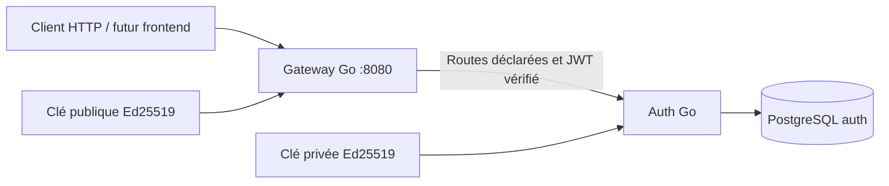
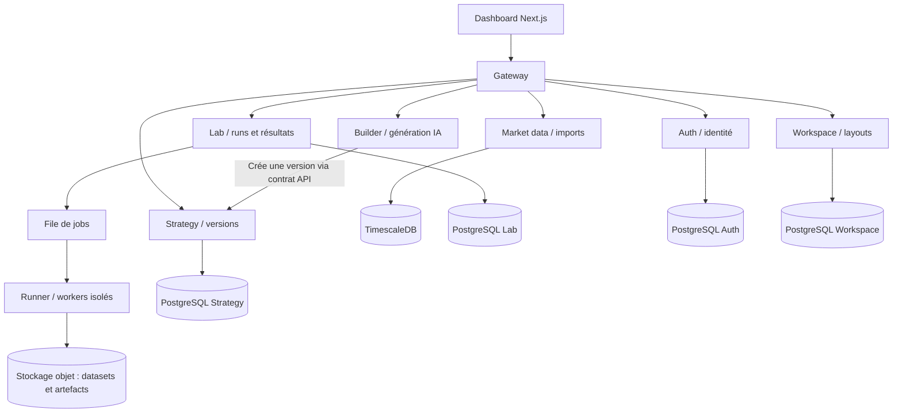

# Analyse et architecture QSlate

## Besoin et état réel du projet

QSlate (nom QuantForge dans certains documents) propose un laboratoire de
recherche quantitative accessible à deux profils : le trader qui veut valider
une idée sans programmer et l'analyste qui veut écrire ses stratégies,
indicateurs et métriques. Le parcours cible est : idée → stratégie versionnée →
backtest sur un dataset identifié → rapport comparable → éventuellement
exécution paper/live. Le dashboard doit conserver les layouts et projets de
chaque utilisateur. Les stratégies constituent des données privées.

Sources locales consultées : `CLIENT NEEDS & FUNCTIONAL SCOPE.pdf`,
`Diagram.pdf`, `CONTEXT, AUDIT & COMPLIANCE.pdf` du projet EIP et le frontend
Next.js, dans `/home/alexis/Tek 4/Qslate_archi/G-EIP-600-PAR-6-1-eip-15-main`.
La référence AREA est `/home/alexis/Tek 4/Qslate_archi/AREA/Backend`.

L'état observé de ce dépôt avant cette tranche :

| Composant | Implémentation existante | Écart avec la cible documentaire |
| --- | --- | --- |
| API | `main.py`, FastAPI ; assets, OHLCV, options, téléchargement et backtest | Pas de gateway Go ni d'identité utilisateur |
| Calcul | `runner_service.py` appelle `job_runner.py` | Le code Python fourni est exécuté par `exec` dans le processus du runner ; aucune isolation par job dans ces fichiers |
| Marché | CSV locaux, pandas et yfinance | TimescaleDB et stockage objet sont une cible, pas une implémentation ici |
| Résultats | Rapport/trades renvoyés après une requête synchrone jusqu'à 600 s | Pas de catalogue de runs, statut persistant, queue ou propriétaire |
| Frontend | Next.js, script editor et dashboard modulaire | Layouts en localStorage ; liens login/register sans parcours de connexion implémenté |
| Builder et live | Décrits dans les documents | Absents du backend consulté |

La séparation API/runner existe déjà, mais ne constitue pas une sandbox.
Un validateur AST apporte un filtre préalable ; il ne remplace pas une
isolation système, des quotas et une politique réseau.

## Ce que l'on reprend d'AREA

AREA est une plateforme d'automatisation, structurée autour d'un gateway et
de services Auth, Area, Service catalog, Webhook, Polling, Cron et Mail. Les
responsabilités métier de QSlate sont différentes : on reprend son organisation
technique, pas son découpage fonctionnel.

Son gateway charge `services-config/**/service.config.json`, route vers des
services Go, applique l'authentification et les règles internes. Le template
AREA contient un `app/cmd`, des couches `http`, `service`, `repository`,
`domain`, une configuration, PostgreSQL et Docker/OpenAPI. Chaque service
possède ses données. Les interfaces de repository et les tests de service
AREA sont déjà de bons points : la base n'est pas requise pour tous ses tests.

Points précis améliorés dans cette tranche :

| Référence AREA consultée | Choix QSlate et raison |
| --- | --- |
| Routes directes et routes préfixées en parallèle | Un chemin public canonique par méthode, liste explicite ; éviter ambiguïtés et collisions |
| JWT HS256 avec secret de développement par défaut dans Auth | Ed25519 : auth signe avec la clé privée, gateway vérifie uniquement avec la clé publique ; clés générées, aucun secret de signature par défaut |
| `isValidUsername` retourne toujours `true` dans le service Auth observé | Validation effective, normalisation email/username et contraintes SQL |
| Couche DB appelle `log.Fatal`, DSN par champs avec SSL désactivé | Erreurs remontées au point d'entrée ; `DATABASE_URL`, pool limité, timeouts et contextes |
| SQL dans `db/init`, exécuté seulement sur une base neuve | Migrations embarquées versionnées avec transaction, verrou concurrent et checksum |
| Template lié à une fausse ressource users | Template neutre et générateur qui réécrit les imports, sans DB obligatoire |
| Multiples modules/configs et Compose par service | Module Go racine pour cette phase : runtime technique partagé, commandes/images séparées, règles métier dans les `internal` de chaque service |
| Secret partagé pour certaines routes internes | Pas de route interne publiée dans cette tranche ; futures identités de service dédiées, pas de confiance dans `X-User-ID` fourni par le client |

Le module commun simplifie CI et maintenance dans ce repository unique.
Il ne partage aucune entité métier ni repository entre services. Chaque
binaire se construit et se déploie indépendamment. Une extraction en modules
versionnés devient pertinente si les équipes/repositories divergent.

## Socle implémenté

Le gateway publie `/api/auth/register`, `/api/auth/login`, `/api/auth/me`.
Les deux premières routes sont limitées à 10 appels par minute et IP,
partagés entre login/register pour une instance de gateway. Le profil exige
un JWT valide au gateway **et** au service. Aucun autre endpoint de service
n'est routé implicitement. Les probes locales `/healthz` et `/readyz` ont
des rôles distincts ; readiness du gateway vérifie les upstreams.

Compose publie uniquement `127.0.0.1:8080`. PostgreSQL n'a aucun port hôte et
se trouve sur un réseau accessible à auth, pas au gateway. La clé privée
n'est montée que dans auth. Les services Go tournent avec un utilisateur
non privilégié, un filesystem en lecture seule et sans capacités Linux.

Le frontend et l'API Python conservent leur configuration actuelle : cette
tranche n'inclut pas encore leur intégration au gateway. Les conteneurs
Python ne sont pas ajoutés au Compose de l'authentification.

## Découpage cible, à implémenter progressivement

| Service | Possède | Ne doit pas faire |
| --- | --- | --- |
| Auth | Comptes, mots de passe ; sessions/MFA à venir | Conserver clés de brokers ou stratégies |
| Workspace | Projets, layouts, préférences, références de widgets | Transformer chaque widget UI en microservice |
| Strategy | Code/version, paramètres, droits d'accès | Exécuter le code utilisateur |
| Market data | Catalogue, import, providers, OHLCV, versions des datasets | Orchestrer un backtest |
| Lab | Admission/quota, lifecycle des runs, référence de stratégie/dataset, résultats | Bloquer une requête interactive pendant un calcul |
| Runner | Consommer un job, lancer/arrêter les workers, déposer les artefacts | Être un endpoint public qui exécute du Python dans son processus |
| Builder | Générer et expliquer une stratégie, validation préalable, quotas IA | Conserver l'identité ou devenir une dépendance obligatoire du Lab |

PostgreSQL par propriétaire logique ; au début plusieurs bases/rôles peuvent
partager un serveur, sans jointures entre services. TimescaleDB et stockage
objet ne sont introduits que lors de l'extraction des données/calculs.
Les contrats HTTP courts restent synchrones. Le futur lancement de backtest
renvoie `202` et un `run_id`; une queue durable traite les jobs avec retry,
idempotence, cancellation et dead-letter. Les événements sont versionnés
(`run.completed.v1`) et une outbox évite les incohérences DB/queue.

## Prochaines tranches

1. Brancher les formulaires du frontend, avec session côté serveur/BFF si l'on
   choisit un cookie HttpOnly ; ajouter refresh/logout et récupération de compte.
2. Extraire Workspace et Strategy, appliquer la propriété des ressources dans
   chaque service ; le JWT identifie une personne, il n'autorise pas toute donnée.
3. Extraire Market data et Lab, figer stratégie/dataset par run.
4. Introduire queue et workers séparés ; durcir l'exécution avec gVisor/Kata,
   quotas CPU/mémoire/temps, réseau contrôlé et séparation des secrets.
5. Builder puis broker/paper/live seulement après cette frontière d'exécution.

La première tranche ne fournit ni refresh token, révocation immédiate, OAuth,
MFA, JWKS ni rotation sans interruption. Les access tokens durent 15 minutes.
Les clés publiques sont injectées par fichier et partagées par déploiement.
Le rate limiter est en mémoire : un stockage commun sera nécessaire si plusieurs
gateways doivent partager les quotas. Un reverse proxy de production devra
fournir une politique explicite de confiance des IP ; ici `RemoteAddr` est
utilisé et les headers forwarded du client ne sont pas des identités fiables.
