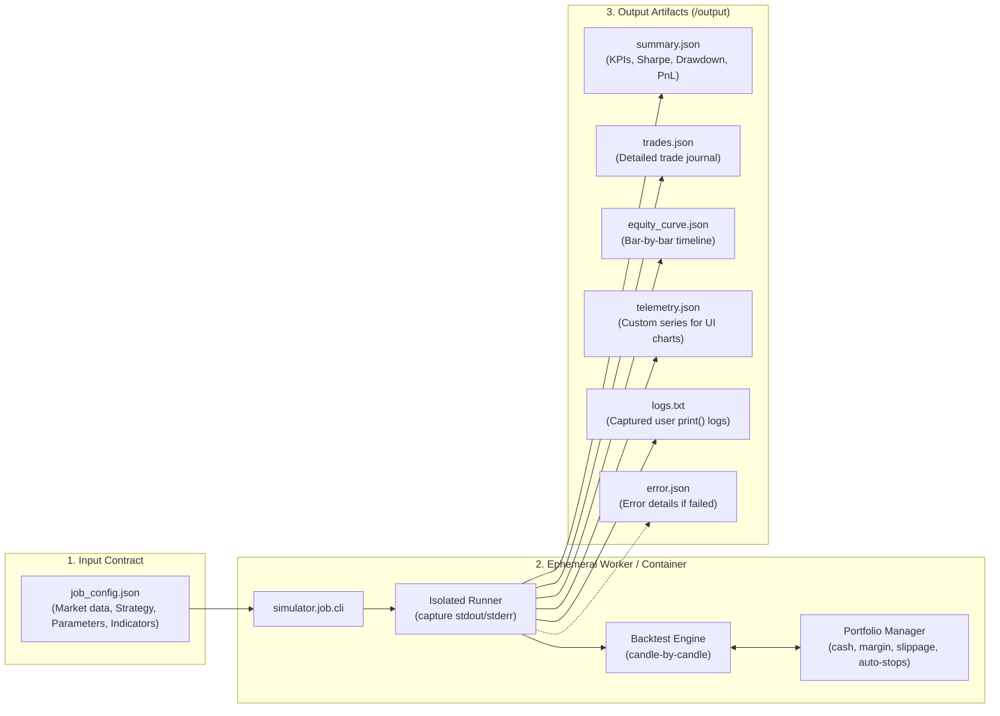

# QSlate Backtesting Engine & Job Runner

## QSlate Lab integration

Imported from branch `18-implement-candle-by-candle-simulation-engine-in-python`
at `fb63ed3180ac263019c1b6524da90826f6b316a2`. The original engine guide below
is retained; deployed execution now uses `python -m simulator.lab_bridge` over
stdin/NDJSON, orchestrated by the independent Go Lab worker. Optional progress
callbacks and bounded log capture were added without changing trading math.
See [Lab](../services/lab/README.md) for actual configuration/security requirements.
Build from repository root with `make simulator-build`; the Docker build context
is this directory. The image defaults to the Lab bridge, **not** the legacy CLI.
To use the original local CLI explicitly, override the entrypoint with
`python -m simulator.job.cli`; never run untrusted strategy code directly on
your host. Tests use generated synthetic CSV fixtures, not developer market data.

A candle-by-candle Python simulation engine designed to run as an ephemeral job.
Its input snapshot can be reproduced, but arbitrary strategy code may still use
time or other non-determinism. Financial calculations use the existing engine's
floating-point implementation; integration does not certify accounting accuracy.

---

## Table of Contents

- [1. Ephemeral Job Architecture](#1-ephemeral-job-architecture)
  - [Why an Ephemeral Job?](#why-an-ephemeral-job)
  - [Job Execution Lifecycle](#job-execution-lifecycle)
  - [Input Specification (Job Configuration)](#input-specification-job-configuration)
  - [Output Specification (Standardized Artifacts)](#output-specification-standardized-artifacts)
- [2. Strategy Development Guide](#2-strategy-development-guide)
  - [Strategy Class Structure & Lifecycle](#strategy-class-structure--lifecycle)
  - [The Trading Context (`Context`) API](#the-trading-context-context-api)
- [3. Marketplace Extensions & Telemetry](#3-marketplace-extensions--telemetry)
  - [Marketplace Indicators](#marketplace-indicators)
  - [Buffered Per-Candle Telemetry (`ctx.record`)](#buffered-per-candle-telemetry-ctxrecord)
  - [External Post-Processing Analytics Modules](#external-post-processing-analytics-modules)
- [4. How to Run Simulations](#4-how-to-run-simulations)
  - [A. Quick Interactive Local Run](#a-quick-interactive-local-run)
  - [B. Testing with Your Own `.py` Strategy](#b-testing-with-your-own-py-strategy)
  - [C. Running as a Job via CLI](#c-running-as-a-job-via-cli)
  - [D. Running via Docker Container](#d-running-via-docker-container)
- [5. Automated Test Suite](#5-automated-test-suite)

---

## 1. Ephemeral Job Architecture

### Why an Ephemeral Job?

In the QSlate microservice ecosystem, user trading scripts contain arbitrary code. Running user code inside a long-lived, multi-tenant HTTP server creates severe security, memory leak, and noisy-neighbor issues.

Instead, the simulator is designed as a **self-contained, ephemeral job runner**:

- **External isolation**: The orchestrator supplies the sandbox and resource/network
  policy. The simulator does not sandbox itself; ordinary Docker alone is not a
  security guarantee. Production Lab configuration requires runsc.
- **Stateless execution**: The standalone CLI writes artifacts and exits with code
  `0` (success) or `1` (failure). Lab instead uses an stdin/NDJSON bridge with a
  result status; a completed bridge process can still report a failed strategy.
- **Separate orchestration**: The Lab Go API admits jobs; a separate Go worker
  owns execution. Neither the gateway nor the API executes user Python.

### Job Execution Lifecycle

The diagram describes the standalone CLI/file-artifact workflow. The deployed
Lab workflow uses `simulator.lab_bridge`, streams NDJSON to the Go worker and
persists artifacts/events in Lab's PostgreSQL database instead of host-mounted
output files.



---

### Input Specification (Job Configuration)

The following is the trusted standalone CLI's `JobConfig`, not the public Lab
REST payload. It accepts local `.py` paths or inline source. Lab accepts authorized
resource/version IDs, freezes source and CSV bytes, and constructs its own private
job envelope; callers cannot submit file paths, indicator modules or analytics
modules through the current Lab `RunInput` contract.

```json
{
  "job_id": "job_demo_aapl_001",
  "dataset": {
    "source": "local_csv",
    "ticker": "AAPL",
    "file_path": "simulator/DATA_1H_AAPL.csv",
    "start_date": "2024-01-01T00:00:00Z",
    "end_date": "2024-12-31T23:59:59Z"
  },
  "strategy": {
    "file_path": "simulator/examples/rsi_trend_strategy.py",
    "parameters": {
      "allocation_usd": 2000.0,
      "rsi_oversold": 28.0,
      "stop_loss_pct": 2.5
    }
  },
  "marketplace_indicators": [
    {
      "name": "supertrend",
      "file_path": "simulator/examples/supertrend_indicator.py",
      "default_params": {
        "period": 10,
        "multiplier": 2.0
      }
    }
  ],
  "analytics_modules": [
    {
      "name": "risk_metrics",
      "file_path": "simulator/examples/risk_analytics.py"
    }
  ],
  "backtest": {
    "initial_capital": 10000.0,
    "window": 50,
    "commission_rate": 0.0005,
    "slippage_bps": 2.0
  },
  "output_dir": "simulator/output/job_demo_aapl_001"
}
```

#### Fields Description:

| Section | Field | Description |
|---|---|---|
| `dataset` | `ticker` / `file_path` | Local CSV lookup symbol or explicit CSV path; no automatic market-data download. |
| `strategy` | `file_path` / `source_code` | Path to `.py` file or raw Python source code containing a `Strategy` subclass. |
| `strategy` | `parameters` | Key-value pairs dynamically injected into the strategy instance. |
| `marketplace_indicators` | `name`, `source_code`/`file_path` | Independent indicator functions accessible via `ctx.indicators.<name>()`. |
| `analytics_modules` | `name`, `source_code`/`file_path` | Post-processing analytics modules called after simulation finishes. |
| `backtest` | `initial_capital` | Initial trading account balance in USD (e.g., `10000.0`). |
| `backtest` | `window` | Previous bars in the rolling history; `on_bar` also sees the current bar, for up to `window + 1` rows. |
| `backtest` | `commission_rate` | Trade fee percentage (e.g., `0.0005` = 0.05%). |
| `backtest` | `slippage_bps` | Slippage in basis points (e.g., `2.0` = 0.02%). |
| `output_dir` | `output_dir` | Destination directory where artifacts are saved. |

---

### Output Specification (Standardized Artifacts)

The standalone CLI writes standard files to `--output-dir`. Examples below show
illustrative formats, not expected performance measurements. Lab's bridge returns
equivalent engine data to its worker; it does not use these output-directory paths.

#### 1. `summary.json`
Executive summary with status, execution time, core performance metrics, and custom metrics:
```json
{
  "job_id": "job_demo_aapl_001",
  "status": "SUCCESS",
  "execution_time_seconds": 4.12,
  "metrics": {
    "total_trades": 10,
    "winning_trades": 8,
    "losing_trades": 2,
    "win_rate_pct": 80.0,
    "initial_capital": 10000.0,
    "final_capital": 10330.70,
    "net_profit_usd": 330.70,
    "return_pct": 3.31,
    "profit_factor": 4.40,
    "max_drawdown_pct": 0.78,
    "max_drawdown_usd": 78.79,
    "sharpe_ratio": 0.599,
    "total_fees_usd": 20.0,
    "strategy_metrics": {},
    "analytics_modules": {}
  },
  "error": null
}
```

#### 2. `trades.json`
Complete trade journal containing every closed trade:
```json
[
  {
    "id": "POS_1",
    "side": "long",
    "entry_date": "2024-04-16T13:30:00Z",
    "exit_date": "2024-04-18T16:30:00Z",
    "entry_price": 171.25,
    "exit_price": 166.91,
    "size_usd": 2000.0,
    "leverage": 1.0,
    "pnl_usd": -51.78,
    "pnl_pct": -2.59,
    "fee_usd": 2.0,
    "exit_reason": "Stop Loss"
  }
]
```

#### 3. `equity_curve.json`
Time-series of account equity recorded at the close of every single bar:
```json
[
  {
    "timestamp": "2024-04-03T17:30:00Z",
    "equity": 10000.0,
    "cash": 10000.0,
    "margin_used": 0.0,
    "unrealized_pnl": 0.0,
    "open_positions": 0
  }
]
```

#### 4. `telemetry.json`
Custom metrics recorded per candle via `ctx.record(...)`, buffered in memory and
exported after the run. Lab delivers these series after completion, not live
per-candle telemetry; only progress callbacks are live.
```json
[
  {
    "timestamp": "2024-03-27T15:30:00Z",
    "rsi_val": 27.4,
    "supertrend_val": 174.03
  }
]
```

#### 5. `logs.txt`
Captured `print()` outputs and warnings emitted by user code during execution.

#### 6. `error.json` *(Generated only if `status == "FAILED"`)*
Structured exception message. The standalone runner includes the traceback in
`logs.txt`; those CLI logs are not automatically redacted. Lab's Go worker bounds
and credential-pattern-redacts captured logs before persistence.

---

## 2. Strategy Development Guide

### Strategy Class Structure & Lifecycle

Strategies must inherit from `simulator.Strategy` and implement any of the lifecycle hooks:

```python
from simulator import Strategy, Context

class MyStrategy(Strategy):
    # Default parameters (can be overridden from the job configuration)
    rsi_period: int = 14
    allocation_usd: float = 1500.0
    stop_loss_pct: float = 2.0
    take_profit_pct: float = 5.0

    def on_init(self, ctx: Context) -> None:
        """Called once before the simulation starts."""
        print(f"Strategy initialized with allocation: ${self.allocation_usd}")
        self.signal_counter = 0

    def on_bar(self, ctx: Context) -> None:
        """Called on every new candle."""
        # Calculate indicators on visible history
        rsi = ctx.indicators.rsi(self.rsi_period)
        if len(rsi) < self.rsi_period + 1:
            return

        current_rsi = float(rsi.iloc[-1])

        # Record buffered per-candle telemetry for frontend charts
        ctx.record(rsi=current_rsi)

        # Place orders
        if not ctx.has_position and current_rsi < 30:
            ctx.buy(
                usd_amount=self.allocation_usd,
                stop_loss=ctx.price * (1.0 - self.stop_loss_pct / 100.0),
                take_profit=ctx.price * (1.0 + self.take_profit_pct / 100.0),
                timeout_bars=48  # Auto-close after 48 bars
            )
            self.signal_counter += 1
        elif ctx.has_position and current_rsi > 70:
            ctx.close_all(reason="RSI Overbought")

    def on_stop(self, ctx: Context) -> dict:
        """Called once after the simulation finishes.

        Can optionally return a dictionary of custom metrics to include in summary.json.
        """
        return {"total_signals_count": self.signal_counter}
```

### The Trading Context (`Context`) API

At every candle, the `ctx` object provides:

- **Market & Account Properties**:
  - `ctx.candle`: Current `Candle` object (`open`, `high`, `low`, `close`, `volume`, `timestamp`).
  - `ctx.price`: Current close price (`float`).
  - `ctx.history`: During `on_bar`, a `pandas.DataFrame` of the previous `window`
    bars plus the current bar. Initialization/stop contexts have their own windows.
  - `ctx.capital`: Available unencumbered cash.
  - `ctx.equity`: Portfolio-reported cash plus its currently recorded unrealized PnL.
  - `ctx.has_position`: `True` if at least one position is currently open.
  - `ctx.position`: First active `Position` or `None`.
  - `ctx.positions`: List of all currently open `Position` objects.

- **Order Methods**:
  - `ctx.buy(usd_amount, leverage=1.0, stop_loss=None, take_profit=None, timeout_bars=None)`: Open a LONG position.
  - `ctx.sell(usd_amount, leverage=1.0, stop_loss=None, take_profit=None, timeout_bars=None)`: Open a SHORT position.
  - `ctx.close(position_id=None, reason="Strategy Exit")`: Queue closure of a specific or primary position.
  - `ctx.close_all(reason="Strategy Exit")`: Queue closure of all currently open positions.

  Order calls queue actions; the engine processes them after `on_bar` returns.
  They do not immediately mutate the context's position list.

- **Indicator & Telemetry Helpers**:
  - `ctx.indicators`: Built-in indicators (`sma`, `ema`, `rsi`, `atr`, `bollinger`, `macd`) and all registered marketplace indicators.
  - `ctx.record(**kwargs)`: Buffers timestamped metrics for later artifact export.

---

## 3. Marketplace Extensions & Telemetry

### Marketplace Indicators

Marketplace indicators are completely decoupled from strategy files. They can be written as standalone `.py` files:

```python
# simulator/examples/supertrend_indicator.py
import pandas as pd

def calculate(data: pd.DataFrame, period: int = 10, multiplier: float = 2.0) -> pd.Series:
    atr = (data["High"] - data["Low"]).rolling(period).mean()
    hl2 = (data["High"] + data["Low"]) / 2.0
    return hl2 + (multiplier * atr)
```

Inside your strategy, access it directly by name:
```python
st = ctx.indicators.supertrend(period=12, multiplier=1.8)
```

### Buffered Per-Candle Telemetry (`ctx.record`)

In-strategy telemetry allows you to export arbitrary numerical series or categorical regimes:
```python
ctx.record(
    sentiment_score=0.82,
    regime="bullish",
    atr_spread=float(ctx.candle.high - ctx.candle.low)
)
```
These values are saved to `telemetry.json` by the standalone CLI. In Lab they are
persisted and delivered as telemetry events at completion. Frontend chart
integration remains separate work.

### External Post-Processing Analytics Modules

You can plug in post-backtest evaluation modules to compute specialized risk or performance metrics:

```python
# simulator/examples/risk_analytics.py
import pandas as pd

def analyze(trades: pd.DataFrame, equity_curve: pd.DataFrame, market_data: pd.DataFrame, initial_capital: float) -> dict:
    total_trades = len(trades)
    avg_win = float(trades[trades["pnl_usd"] > 0]["pnl_usd"].mean()) if not trades.empty else 0.0
    return {
        "analyzed_market_bars": len(market_data),
        "total_trades_count": total_trades,
        "avg_win_usd": round(avg_win, 2)
    }
```

The output will automatically appear under `metrics.analytics_modules.risk_analytics` in `summary.json`.

---

## 4. How to Run Simulations

Run the following from the repository root with only trusted local code and
operator-provided CSV data. Standalone examples are developer tools, not a secure
multi-tenant execution path. Use the Lab service/worker for user submissions.
For direct Python use, install `simulator/requirements.txt` in a dedicated virtual
environment; root `requirements.txt` belongs to the legacy FastAPI prototype.

### A. Quick Interactive Local Run

To load the example configuration without writing JSON:

```bash
python simulator/tests/run_test.py
```

This requires your own local AAPL CSV; no dataset is bundled. Configure the CSV
path/ticker in `simulator/examples/config_local.json` before running it.

### B. Testing with Your Own `.py` Strategy

Run your custom strategy file directly:

```bash
python simulator/tests/run_test.py \
  --config '' \
  --strategy path/to/my_strategy.py \
  --ticker AAPL \
  --data-file path/to/prices.csv \
  --capital 20000 \
  --indicator supertrend=simulator/examples/supertrend_indicator.py \
  --analytics risk=simulator/examples/risk_analytics.py
```

`--config ''` is required when using individual flags: the helper otherwise
loads its default JSON configuration and ignores those flag overrides.

### C. Running as a Job via CLI

This is the standalone file-artifact CLI, not the default Lab image entrypoint:

```bash
python -m simulator.job.cli --config simulator/examples/config_local.json --output-dir ./results
```

You can also pipe the configuration directly from `stdin`:
```bash
python -m simulator.job.cli --config - --output-dir ./results < job_config.json
```

### D. Running via Docker Container

Build the image used by Lab:
```bash
make simulator-build
```

The image defaults to `simulator.lab_bridge` and expects a private Lab envelope
on stdin. Do not pass CLI `--config` arguments to that entrypoint. For a trusted
standalone example only, explicitly override the entrypoint and mount a real
local CSV plus a writable results directory:
```bash
mkdir -p results
docker run --rm --network none --read-only \
  --user "$(id -u):$(id -g)" --cap-drop ALL \
  --security-opt no-new-privileges --memory 512m --pids-limit 64 \
  --tmpfs /work:rw,noexec,nosuid,nodev,size=64m,mode=1777 \
  --mount "type=bind,src=$(pwd)/simulator/DATA_1H_AAPL.csv,dst=/app/DATA_1H_AAPL.csv,readonly" \
  --mount "type=bind,src=$(pwd)/results,dst=/output" \
  --entrypoint python qslate-simulator:fb63ed3-lab-v1 \
  -B -m simulator.job.cli \
  --config simulator/examples/config_local.json --output-dir /output
```

The CSV must already exist and be readable by the selected UID. This trusted-local
example uses host mounts and does not validate runsc isolation. Production Lab jobs
use no host mounts or network and are created only by the configured Go worker.

---

## 5. Automated Test Suite

Run the fixed-fixture engine tests and real Go-to-Python transport checks:

```bash
make simulator-test
make test-engine
```

These targets build the image and use generated synthetic data, not downloaded
market data. The transport test uses runc only for fixed repository-owned
fixtures; production configuration rejects that runtime. They do not certify a
runsc deployment or financial correctness. With simulator dependencies installed,
the Python-only suite can also run with
`python -B -m unittest discover -s simulator/tests -p 'test_*.py'`.
