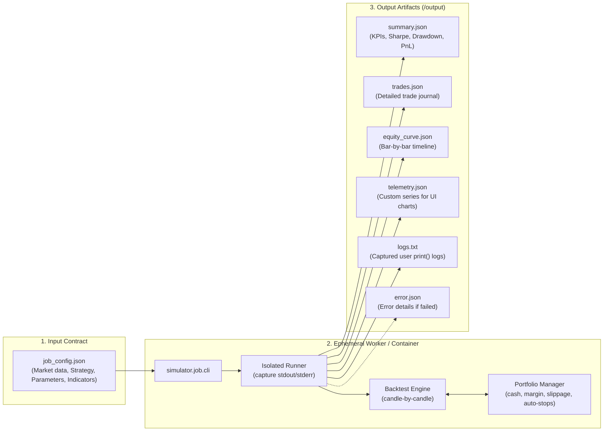

# QSlate Backtesting Engine & Job Runner

A high-performance, deterministic, candle-by-candle Python simulation engine designed specifically to run as an **ephemeral job** within a modern cloud / microservices architecture.

---

## Table of Contents

- [1. Ephemeral Job Architecture](#1-ephemeral-job-architecture)
  - [Why an Ephemeral Job?](#why-an-ephemeral-job)
  - [Job Execution Lifecycle](#job-execution-lifecycle)
  - [Input Specification (Job Configuration)](#input-specification-job-configuration)
  - [Output Specification (Standardized Artifacts)](#output-specification-standardized-artifacts)
- [2. Strategy Development Guide](#2-strategy-development-guide)
  - [Strategy Class Structure & Lifecycle](#strategy-class-structure--lifecycle)
  - [The Trading Context (`Context`) API](#the-trading-context-context-api)
- [3. Marketplace Extensions & Telemetry](#3-marketplace-extensions--telemetry)
  - [Marketplace Indicators](#marketplace-indicators)
  - [Real-Time Telemetry Streaming (`ctx.record`)](#real-time-telemetry-streaming-ctxrecord)
  - [External Post-Processing Analytics Modules](#external-post-processing-analytics-modules)
- [4. How to Run Simulations](#4-how-to-run-simulations)
  - [A. Quick Interactive Local Run](#a-quick-interactive-local-run)
  - [B. Testing with Your Own `.py` Strategy](#b-testing-with-your-own-py-strategy)
  - [C. Running as a Job via CLI](#c-running-as-a-job-via-cli)
  - [D. Running via Docker Container](#d-running-via-docker-container)
- [5. Automated Test Suite](#5-automated-test-suite)

---

## 1. Ephemeral Job Architecture

### Why an Ephemeral Job?

In the QSlate microservice ecosystem, user trading scripts contain arbitrary code. Running user code inside a long-lived, multi-tenant HTTP server creates severe security, memory leak, and noisy-neighbor issues.

Instead, the simulator is designed as a **self-contained, ephemeral job runner**:
- **Strict Isolation**: Runs inside a single-use container or sandboxed worker (Docker, Kubernetes Job, AWS ECS Task, or Google Cloud Run Job).
- **Stateless & Deterministic**: Receives an immutable input configuration, executes the simulation deterministically, writes standardized output files, and exits with code `0` (success) or `1` (failure).
- **Decoupled Orchestration**: The Go API gateway and job orchestrator manage queuing, user authentication, and resource limits without ever executing Python code directly.

### Job Execution Lifecycle



---

### Input Specification (Job Configuration)

Jobs are configured via a JSON payload. In production, code strings are provided directly; in local development, paths to `.py` files can be referenced using `file_path`.

```json
{
  "job_id": "job_demo_aapl_001",
  "dataset": {
    "source": "local_csv",
    "ticker": "AAPL",
    "file_path": "simulator/DATA_1H_AAPL.csv",
    "start_date": "2024-01-01T00:00:00Z",
    "end_date": "2024-12-31T23:59:59Z"
  },
  "strategy": {
    "file_path": "simulator/examples/rsi_trend_strategy.py",
    "parameters": {
      "allocation_usd": 2000.0,
      "rsi_oversold": 28.0,
      "stop_loss_pct": 2.5
    }
  },
  "marketplace_indicators": [
    {
      "name": "supertrend",
      "file_path": "simulator/examples/supertrend_indicator.py",
      "default_params": {
        "period": 10,
        "multiplier": 2.0
      }
    }
  ],
  "analytics_modules": [
    {
      "name": "risk_metrics",
      "file_path": "simulator/examples/risk_analytics.py"
    }
  ],
  "backtest": {
    "initial_capital": 10000.0,
    "window": 50,
    "commission_rate": 0.0005,
    "slippage_bps": 2.0
  },
  "output_dir": "simulator/output/job_demo_aapl_001"
}
```

#### Fields Description:
| Section | Field | Description |
|---|---|---|
| `dataset` | `ticker` / `file_path` | Asset symbol or direct path to OHLCV data. |
| `strategy` | `file_path` / `source_code` | Path to `.py` file or raw Python source code containing a `Strategy` subclass. |
| `strategy` | `parameters` | Key-value pairs dynamically injected into the strategy instance. |
| `marketplace_indicators` | `name`, `source_code`/`file_path` | Independent indicator functions accessible via `ctx.indicators.<name>()`. |
| `analytics_modules` | `name`, `source_code`/`file_path` | Post-processing analytics modules called after simulation finishes. |
| `backtest` | `initial_capital` | Initial trading account balance in USD (e.g., `10000.0`). |
| `backtest` | `window` | Number of historical bars visible to the strategy at each step. |
| `backtest` | `commission_rate` | Trade fee percentage (e.g., `0.0005` = 0.05%). |
| `backtest` | `slippage_bps` | Slippage in basis points (e.g., `2.0` = 0.02%). |
| `output_dir` | `output_dir` | Destination directory where artifacts are saved. |

---

### Output Specification (Standardized Artifacts)

When execution completes, the job writes standard files to the designated `--output-dir`:

#### 1. `summary.json`
Executive summary with status, execution time, core performance metrics, and custom metrics:
```json
{
  "job_id": "job_demo_aapl_001",
  "status": "SUCCESS",
  "execution_time_seconds": 4.12,
  "metrics": {
    "total_trades": 10,
    "winning_trades": 8,
    "losing_trades": 2,
    "win_rate_pct": 80.0,
    "initial_capital": 10000.0,
    "final_capital": 10330.70,
    "net_profit_usd": 330.70,
    "return_pct": 3.31,
    "profit_factor": 4.40,
    "max_drawdown_pct": 0.78,
    "max_drawdown_usd": 78.79,
    "sharpe_ratio": 0.599,
    "total_fees_usd": 20.0,
    "strategy_metrics": { ... },
    "analytics_modules": { ... }
  },
  "error": null
}
```

#### 2. `trades.json`
Complete trade journal containing every closed trade:
```json
[
  {
    "id": "POS_1",
    "side": "long",
    "entry_date": "2024-04-16T13:30:00Z",
    "exit_date": "2024-04-18T16:30:00Z",
    "entry_price": 171.25,
    "exit_price": 166.91,
    "size_usd": 2000.0,
    "leverage": 1.0,
    "pnl_usd": -51.78,
    "pnl_pct": -2.59,
    "fee_usd": 2.0,
    "exit_reason": "Stop Loss"
  }
]
```

#### 3. `equity_curve.json`
Time-series of account equity recorded at the close of every single bar:
```json
[
  {
    "timestamp": "2024-04-03T17:30:00Z",
    "equity": 10000.0,
    "cash": 10000.0,
    "margin_used": 0.0,
    "unrealized_pnl": 0.0,
    "open_positions": 0
  }
]
```

#### 4. `telemetry.json`
Real-time custom metrics recorded during the simulation via `ctx.record(...)`. Allows frontend charts to render user-defined curves:
```json
[
  {
    "timestamp": "2024-03-27T15:30:00Z",
    "rsi_val": 27.4,
    "supertrend_val": 174.03
  }
]
```

#### 5. `logs.txt`
Captured `print()` outputs and warnings emitted by user code during execution.

#### 6. `error.json` *(Generated only if `status == "FAILED"`)*
Structured diagnostic error message with filtered traceback indicating the exact user code failure.

---

## 2. Strategy Development Guide

### Strategy Class Structure & Lifecycle

Strategies must inherit from `simulator.Strategy` and implement any of the lifecycle hooks:

```python
from simulator import Strategy, Context

class MyStrategy(Strategy):
    # Default parameters (can be overridden from the job configuration)
    rsi_period: int = 14
    allocation_usd: float = 1500.0
    stop_loss_pct: float = 2.0
    take_profit_pct: float = 5.0

    def on_init(self, ctx: Context) -> None:
        """Called once before the simulation starts."""
        print(f"Strategy initialized with allocation: ${self.allocation_usd}")
        self.signal_counter = 0

    def on_bar(self, ctx: Context) -> None:
        """Called on every new candle."""
        # Calculate indicators on visible history
        rsi = ctx.indicators.rsi(self.rsi_period)
        if len(rsi) < self.rsi_period + 1:
            return

        current_rsi = float(rsi.iloc[-1])

        # Record real-time telemetry for frontend charts
        ctx.record(rsi=current_rsi)

        # Place orders
        if not ctx.has_position and current_rsi < 30:
            ctx.buy(
                usd_amount=self.allocation_usd,
                stop_loss=ctx.price * (1.0 - self.stop_loss_pct / 100.0),
                take_profit=ctx.price * (1.0 + self.take_profit_pct / 100.0),
                timeout_bars=48  # Auto-close after 48 hours
            )
            self.signal_counter += 1
        elif ctx.has_position and current_rsi > 70:
            ctx.close_all(reason="RSI Overbought")

    def on_stop(self, ctx: Context) -> dict:
        """Called once after the simulation finishes.

        Can optionally return a dictionary of custom metrics to include in summary.json.
        """
        return {"total_signals_count": self.signal_counter}
```

### The Trading Context (`Context`) API

At every candle, the `ctx` object provides:

- **Market & Account Properties**:
  - `ctx.candle`: Current `Candle` object (`open`, `high`, `low`, `close`, `volume`, `timestamp`).
  - `ctx.price`: Current close price (`float`).
  - `ctx.history`: `pandas.DataFrame` of the last `window` historical bars.
  - `ctx.capital`: Available unencumbered cash.
  - `ctx.equity`: Total account liquidation value (cash + unrealized PnL).
  - `ctx.has_position`: `True` if at least one position is currently open.
  - `ctx.position`: First active `Position` or `None`.
  - `ctx.positions`: List of all currently open `Position` objects.

- **Order Methods**:
  - `ctx.buy(usd_amount, leverage=1.0, stop_loss=None, take_profit=None, timeout_bars=None)`: Open a LONG position.
  - `ctx.sell(usd_amount, leverage=1.0, stop_loss=None, take_profit=None, timeout_bars=None)`: Open a SHORT position.
  - `ctx.close(position_id=None, reason="Exit")`: Close a specific position or the primary position.
  - `ctx.close_all(reason="Exit")`: Close all open positions immediately.

- **Indicator & Telemetry Helpers**:
  - `ctx.indicators`: Built-in indicators (`sma`, `ema`, `rsi`, `atr`, `bollinger`, `macd`) and all registered marketplace indicators.
  - `ctx.record(**kwargs)`: Streams time-stamped metrics into `telemetry.json`.

---

## 3. Marketplace Extensions & Telemetry

### Marketplace Indicators

Marketplace indicators are completely decoupled from strategy files. They can be written as standalone `.py` files:

```python
# simulator/examples/supertrend_indicator.py
import pandas as pd

def calculate(data: pd.DataFrame, period: int = 10, multiplier: float = 2.0) -> pd.Series:
    atr = (data["High"] - data["Low"]).rolling(period).mean()
    hl2 = (data["High"] + data["Low"]) / 2.0
    return hl2 + (multiplier * atr)
```

Inside your strategy, access it directly by name:
```python
st = ctx.indicators.supertrend(period=12, multiplier=1.8)
```

### Real-Time Telemetry Streaming (`ctx.record`)

In-strategy telemetry allows you to export arbitrary numerical series or categorical regimes:
```python
ctx.record(
    sentiment_score=0.82,
    regime="bullish",
    atr_spread=float(ctx.candle.high - ctx.candle.low)
)
```
These values are saved to `telemetry.json` and can be visualized as sub-charts on the frontend.

### External Post-Processing Analytics Modules

You can plug in post-backtest evaluation modules to compute specialized risk or performance metrics:

```python
# simulator/examples/risk_analytics.py
import pandas as pd

def analyze(trades: pd.DataFrame, equity_curve: pd.DataFrame, market_data: pd.DataFrame, initial_capital: float) -> dict:
    total_trades = len(trades)
    avg_win = float(trades[trades["pnl_usd"] > 0]["pnl_usd"].mean()) if not trades.empty else 0.0
    return {
        "analyzed_market_bars": len(market_data),
        "total_trades_count": total_trades,
        "avg_win_usd": round(avg_win, 2)
    }
```

The output will automatically appear under `metrics.analytics_modules.risk_analytics` in `summary.json`.

---

## 4. How to Run Simulations

### A. Quick Interactive Local Run

To test the entire engine with the example strategy and data without writing any JSON:

```bash
python simulator/tests/run_test.py
```

### B. Testing with Your Own `.py` Strategy

Run your custom strategy file directly:

```bash
python simulator/tests/run_test.py \
  --strategy path/to/my_strategy.py \
  --ticker AAPL \
  --capital 20000 \
  --indicator supertrend=simulator/examples/supertrend_indicator.py \
  --analytics risk=simulator/examples/risk_analytics.py
```

### C. Running as a Job via CLI

This is the standard execution command used in production containers:

```bash
python -m simulator.job.cli --config simulator/examples/config_local.json --output-dir ./results
```

You can also pipe the configuration directly from `stdin`:
```bash
cat job_config.json | python -m simulator.job.cli --config - --output-dir ./results
```

### D. Running via Docker Container

Build the lightweight container image:
```bash
docker build -t qslate-simulator simulator/
```

Run a job inside the container:
```bash
docker run --rm \
  -v $(pwd)/simulator/examples:/app/config:ro \
  -v $(pwd)/results:/app/results \
  qslate-simulator \
  --config /app/config/config_local.json \
  --output-dir /app/results
```

---

## 5. Automated Test Suite

Run the full automated test suite (portfolio math, auto-stops, slippage, engine, job runner, error isolation):

```bash
python -m unittest discover simulator/tests
```
